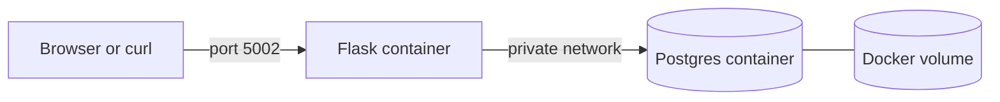

# Week 11: Portfolio Project

A Flask web app that counts page visits in Postgres, deployed entirely with
Terraform through the Docker provider.

## Architecture


## What Terraform creates
Six resources: a private network, a named volume, the Postgres image, the web
image (built from `app/`), the database container, and the web container.

## How to run
```
cd terraform
read -s -p "DB password: " TF_VAR_db_password; echo
export TF_VAR_db_password
terraform init
terraform apply
curl localhost:5002
terraform destroy
```

## Design choices
- The database password is a sensitive variable read from an environment
  variable, so it is never written to a file or committed.
- The database port is not published. Only the web app is reachable from
  the host.
- A healthcheck plus `wait = true` makes Terraform start the web container
  only after Postgres is ready.
- A named volume keeps data when containers are replaced. `terraform destroy`
  removes it.
- The web image rebuilds when the app files change, using a hash of the
  source files as a trigger.
- `keep_locally` on the Postgres image stops Terraform from deleting an image
  other projects use.

## CI
Every pull request checks formatting and validity of both Terraform folders,
lints the Python, runs tests, and builds all three Docker images.

## Limits and what I would change
- State is stored locally, and it contains the password in plain text. A team
  would use remote, locked-down state.
- It deploys to my own machine. The same workflow applies to a cloud provider
  by swapping the provider and resources.
